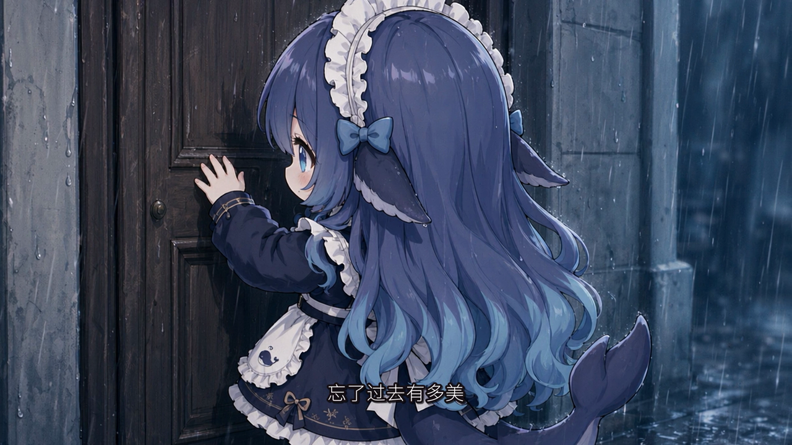

# AI 音乐 MV《为你我受冷风吹》

用代码给一首歌做一支 AI 音乐 MV 的完整工程。

- 音频分析：BPM 117.5、490+ 节拍点、12 个情绪段落（song-analysis.json）
- AIGC 素材：13 张关键帧 + 4 段 AI 生成视频
- 字幕：ASS / SRT 逐句歌词
- 成片：音画同步剪辑输出（本仓库收录 53MB 压缩版；原 105MB 完整版受 GitHub 单文件 100MB 限制未收录）

---

> 个人项目，仅供展示。
